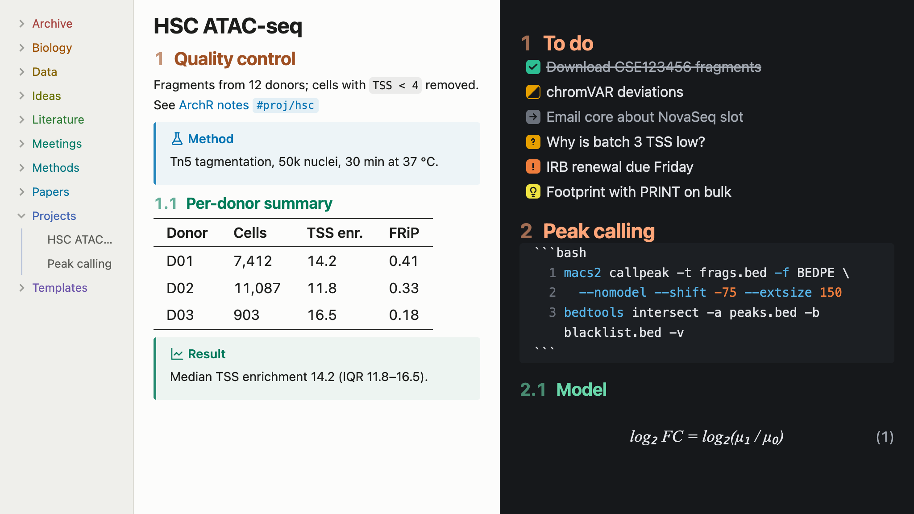
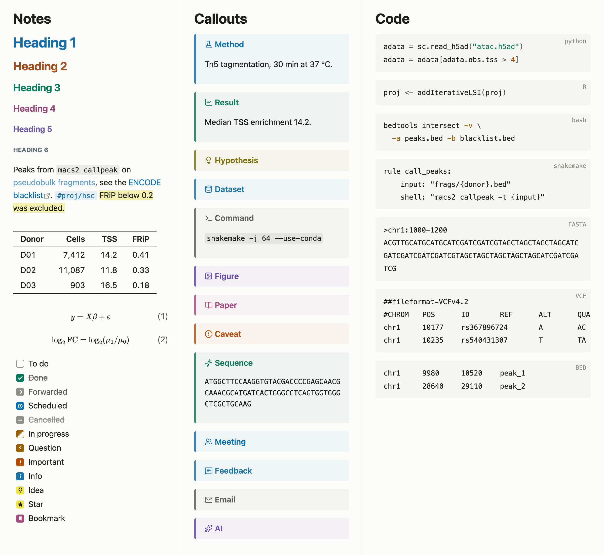
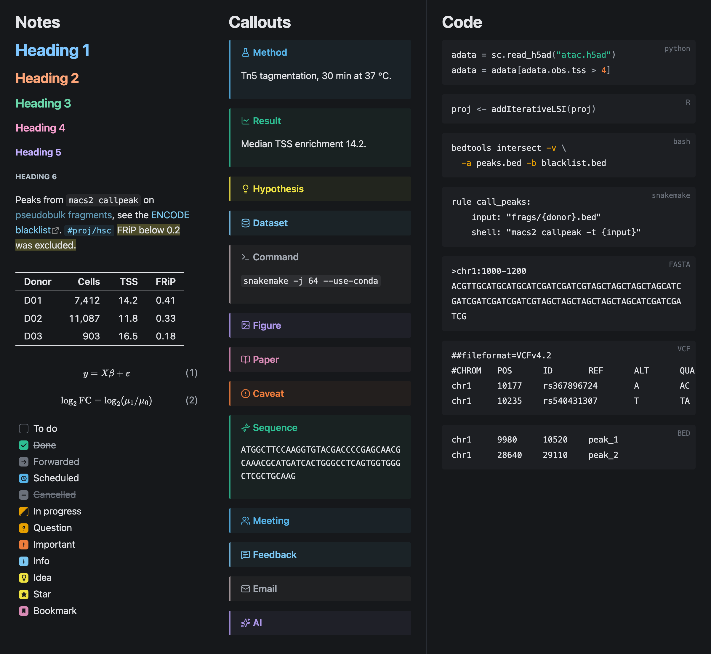

# Locus

An Obsidian theme for computational biologists and bioinformaticians who keep their lab notebook in Obsidian. Its colors are built on the colorblind-friendly Okabe–Ito palette, the one you'd use in a figure.

| Element | Encoding |
| --- | --- |
| Heading levels H1–H6 | blue, orange, green, rose, violet, slate, all at one OKLCH lightness and chroma, so no level is louder than another and size carries the hierarchy |
| Folders | one muted blue-gray, the accent's hue at low chroma, a moderate step away from file names |
| Callouts, task states, syntax tokens, graph nodes | Okabe–Ito, darkened in light mode to ≥4.5:1 contrast |
| Accent color | Okabe–Ito blue (light) / sky blue (dark) |
| Highlights (`==text==`) | Okabe–Ito yellow |

## Install

Requires Obsidian 1.15 or later.

Open **Settings → Appearance → Themes → Manage**, search for "Locus", and choose **Install and use**.

To install manually, download `manifest.json` and `theme.css` from the [latest release](https://github.com/Jeff1995/Locus/releases/latest) into `<vault>/.obsidian/themes/Locus/`, then choose Locus under **Settings → Appearance → Themes**.

Copy `showcase.md` into your vault and open it to see every feature.

## Features

**Outline pane:** headings in the Outline get the same colors as in the note. The pane doesn't record each item's heading level, only how deeply it's nested, so Locus colors by depth and assumes the top level is the H1 title. This matches the note whenever it starts with a single H1 and doesn't skip levels.

Locus doesn't number headings. For numbered headings, use the [Number Headings](https://github.com/onlyafly/number-headings-obsidian) community plugin, which writes the numbers into the headings themselves.

**Equation numbers:** display math (`$$ … $$`) is numbered (1), (2), … at the right margin in reading view and live preview; inline math is not. In live preview the number hides while the pointer is over the block, so it doesn't collide with the edit button. Obsidian only renders the part of a long note near the screen, so in a note several screens long the numbers can be off after you scroll far down.

**Code line numbers:** code blocks show line numbers in the editor (live preview and source mode). Reading view can't number lines, because it renders a code block as one run of text.

**Due-date urgency (Tasks plugin):** an open task's due date turns vermillion when overdue and orange when due today, and its checkbox gets a matching outline. The outline shows even when a query hides due dates. Done and cancelled tasks are left alone. This applies wherever Tasks renders tasks: query results and reading view.

**Tables:** booktabs rules (top, header, and bottom only) with tabular numerals so digits line up in columns. Dataview tables get the same treatment.

**Code:**
- Colorblind-safe syntax colors.
- A language label in reading view (`python`, `R`, `bash`, `snakemake`, `nextflow`, `SQL`, …).
- Sequence blocks (`fasta`, `fastq`, `dna`, `rna`, `protein`) wrap at any character, so a long insert doesn't become a single endless line.
- Tab-delimited blocks (`vcf`, `bed`, `sam`, `gtf`, `gff`, `tsv`) never wrap: columns stay aligned and the block scrolls sideways.

**Task states:**

| Syntax | Meaning | Look |
| --- | --- | --- |
| `[ ]` | to do | empty box |
| `[x]` | done | green ✓, struck through |
| `[>]` | forwarded | gray →, text muted |
| `[<]` | scheduled | blue clock |
| `[-]` | cancelled | gray −, struck through |
| `[/]` | in progress | half-filled orange |
| `[?]` | question | orange ? |
| `[!]` | important | vermillion ! |
| `[i]` | info | sky-blue i |
| `[I]` | idea | yellow lightbulb |
| `[*]` | star | yellow star |
| `[b]` | bookmark | purple bookmark |

**Callouts:** besides recoloring the built-in callouts, Locus adds these:

| Type (aliases) | Icon |
| --- | --- |
| `method` (`protocol`) | flask |
| `result` (`finding`) | line chart |
| `hypothesis` (`idea`) | lightbulb |
| `dataset` (`data`) | database |
| `cmd` (`command`, `run`) | terminal |
| `figure` | image |
| `paper` (`reference`) | book |
| `caveat` (`problem`) | octagon alert |
| `sequence` (`seq`, `primer`) | DNA; the body is set in monospace and breaks at any character |
| `meeting` | people |
| `feedback` | speech bubble |
| `email` | envelope |
| `ai` | sparkles |

**Iconize icons:** every Iconize icon takes the color of the text next to it, in the file explorer and on tabs, overriding any color picked for the icon.

**Other details:** tags and property keys are set in monospace (they are identifiers), internal links are underlined only on hover, links, equations, code and other inline elements in a heading keep the heading color, and the active line in the editor gets a faint tint.

## Options

If the [Style Settings](https://github.com/mgmeyers/obsidian-style-settings) plugin is installed, you can turn off individual features: colored headings, equation numbers, code line numbers, due-date urgency, folder colors, booktabs tables, code labels, custom checkboxes, and the active-line tint. Every feature is on by default, with or without the plugin.

## License

[MIT](LICENSE)
